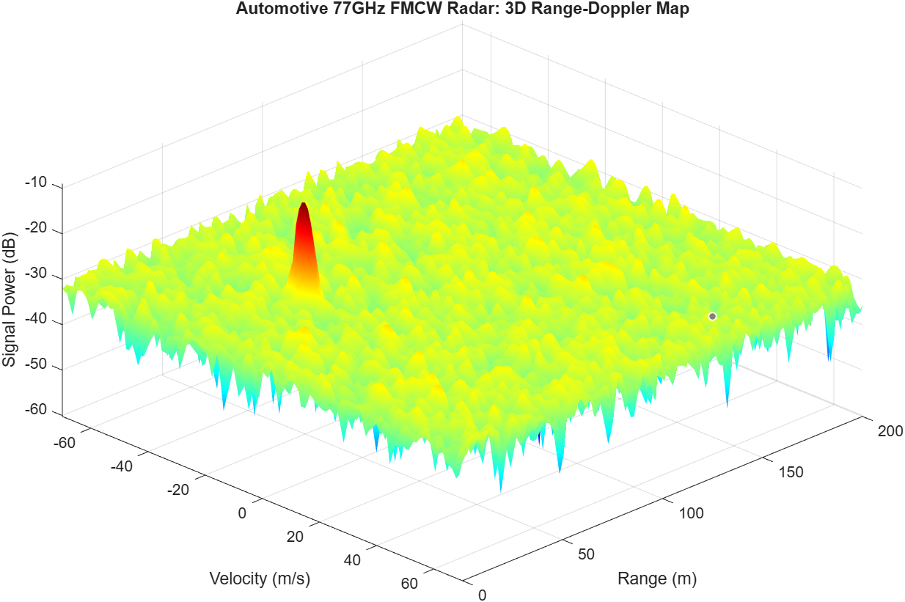

# Automotive 77GHz FMCW Radar: Target Detection

A MATLAB-based simulation of an automotive Advanced Driver Assistance System (ADAS) radar. This project models a 77 GHz Frequency-Modulated Continuous-Wave (FMCW) radar system to detect the range and radial velocity of a moving target (e.g., a vehicle 50 meters ahead traveling at 20 m/s).

## System Architecture
1. **Waveform Generation:** Configured a 77 GHz FMCW waveform with custom sweep time and bandwidth mapped to a 200m maximum range and 1m range resolution.
2. **Channel & Target Modeling:** Simulated a Free Space propagation channel and defined a radar target with a specific Radar Cross Section (RCS) moving at a constant velocity. 
3. **Signal Mixing (Dechirping):** Simulated the transmission of 128 chirps per frame, mixing the received echoes with the transmitted signal to extract the beat frequencies.
4. **Range-Doppler Processing:** Applied a 2D Fast Fourier Transform (FFT) to the raw radar data cube to generate a 3D Range-Doppler map, accurately isolating the target's distance (50m) and speed (20m/s).

## Tech Stack & Toolboxes
* **Environment:** MATLAB
* **Toolboxes Used:** Phased Array System Toolbox
* **Core Concepts:** FMCW Radar, 2D FFT, Range-Doppler Processing, ADAS, Signal Dechirping
